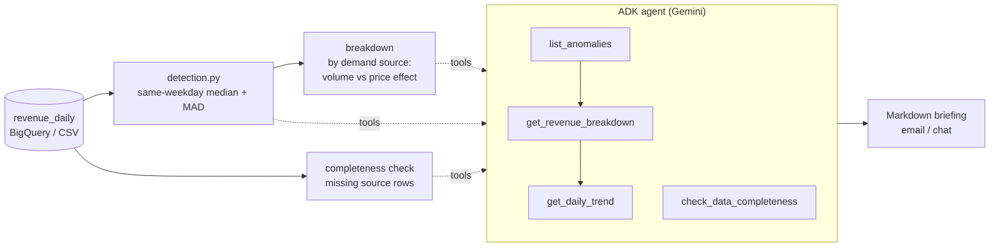

# Ad-revenue anomaly agent

[](https://github.com/thanzap/ad-revenue-anomaly-agent/actions/workflows/ci.yml)


Every morning an ad-ops team needs to know: **which publishers' revenue moved yesterday, why, and who to call.**
This project answers that in two layers:

1. **Deterministic detection** in pandas, with the same logic in BigQuery SQL. It flags anomalies, finds data
   gaps and decomposes every change by demand source into *volume* (impressions) and *price* (eCPM) effects.
2. **An LLM agent** ([Google ADK](https://google.github.io/adk-docs/), Gemini) that investigates each finding
   with those functions as tools and writes the briefing: classification, evidence and next action.

It is a public, from-scratch reference version of a system I built and run in production for a programmatic
advertising network. Data here is synthetic, with four known incidents injected so the behaviour can be
asserted in tests.

## Example output

`python -m anomaly_agent.cli --no-llm` (deterministic report, no credentials needed):

```markdown
# Revenue anomalies: 2026-11-09

**3 anomalies vs same-weekday baseline: -924 € at risk, +1,343 € unexpected uplift.**

## tech-reviews: +85.1% (+1,343 €), `traffic_change`
- Revenue 2,920 € vs baseline 1,577 € (robust z = 42.57)
- Largest mover: **ssp_alpha** +459 € (volume +454 €, price +5 €)
- Next action: Confirm the traffic source in analytics; check viewability and invalid traffic.

## daily-sports: -23.8% (-645 €), `single_source_outage`
- Revenue 2,067 € vs baseline 2,712 € (robust z = -11.85)
- Largest mover: **ssp_beta** -814 € (volume +22 €, price -836 €)
- Next action: Check ssp_beta bidder errors, ads.txt lines and contract status; contact the partner.

## travel-mag: -38.5% (-279 €), `price_change`
  ...
## Data quality
- Missing rows: **food-blog / ssp_gamma**. Re-run the ingestion for the missing source before trusting this day.
```

The agent produces the same structure in prose and can answer follow-ups ("Why did daily-sports drop? Who do we
call?") by calling the tools again.

## How it works



**Detection decisions**

| Choice | Why |
|---|---|
| Baseline = median of the **same weekday** over the previous 4 weeks | Ad revenue has a strong weekly cycle. Monday vs last Mondays beats a rolling 7-day mean. |
| Spread = **MAD** × 1.4826, floored at 2 % of the baseline | One past outlier can't widen the band and hide the next incident (there's a test for this). The floor stops very stable series from alerting on noise. |
| Flag only if **\|Δ%\| ≥ 20 % and \|z\| ≥ 3** | The first condition drops small publishers' noise, the second drops volatile publishers' normal swings. Zero false positives across 39 normal days in the test data. |
| **Missing rows ≠ revenue drop** | A source that reported for 14 straight days and is absent today is a pipeline problem. It is reported separately so nobody calls a partner about an ETL failure. |
| Δrevenue = **volume effect + price effect** (exact) | Separates "we lost traffic" from "demand paid less", which go to different teams. |

**Agent decisions**

- The LLM never detects anything. It explains deterministic findings, so a model mistake can produce a bad
  sentence but never a missed or invented anomaly.
- Tools are typed, documented and return `{"status": "error", ...}` instead of raising, so the model can recover.
- The instruction fixes the procedure (completeness → anomalies → breakdown per anomaly → trend if needed) and
  forbids numbers that didn't come from a tool.
- `temperature=0.1`, retries on transient API errors.

## Evaluation

[`tests/eval/datasets/triage-dataset.json`](tests/eval/datasets/triage-dataset.json) has five cases: full daily
triage, a single-publisher follow-up, a quiet day, a data gap that must not be read as a drop, and an invalid
date. References are generated from the deterministic report. Metrics
([`eval_config.yaml`](tests/eval/eval_config.yaml)):

- `custom_response_quality`: LLM-as-judge against the reference briefing
- `classification_recall`: deterministic; did the agent name every expected label?
- `tool_call_count`: a briefing produced with no drill-down calls is a guess

```bash
agents-cli eval run          # needs GEMINI_API_KEY or Gemini platform credentials
```

## Run it

```bash
uv sync
uv run pytest -q tests/unit                      # 13 tests: detection, tools, agent wiring, report
uv run python -m anomaly_agent.cli --no-llm      # deterministic report

cp .env.example .env                             # set GEMINI_API_KEY (or Gemini platform project)
uv run python -m anomaly_agent.cli               # agent-written briefing
agents-cli playground                            # chat with the agent in the ADK web UI
```

In production the same detection runs as BigQuery SQL ([`sql/detect_anomalies.sql`](sql/detect_anomalies.sql)),
scheduled after the daily revenue load, and the agent is deployed to Agent Runtime with the briefing sent by
email. `agents-cli scaffold enhance` adds the deployment target and Terraform.

## Layout

```
anomaly_agent/
  data.py        synthetic revenue table with injected incidents (seeded)
  detection.py   detection, completeness, volume/price decomposition, rule-based labels
  tools.py       ADK function tools over detection.py
  agent.py       the ADK agent and its instruction
  report.py      deterministic Markdown briefing (fallback + eval reference)
  cli.py         daily entry point
sql/             BigQuery version of the detection query
tests/unit/      pytest suite (runs in CI)
tests/eval/      agent eval dataset and metrics
```

---

Built by **Thanasis Zapatetas** · Apache-2.0
